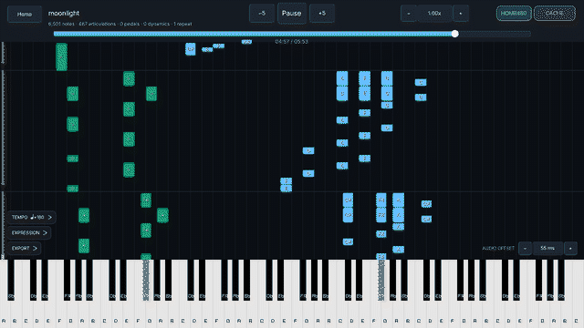

# Sheet2Play

> Turns sheet music into synchronized, falling-note piano playback.

Sheet2Play reads sheet music — a PDF, a scan, or a photo — runs it through an Optical Music
Recognition (OMR) pipeline, and renders the result as a Synthesia-style piano roll you can
play back, scrub, and slow down.



**[Download for Windows](https://github.com/Artemixss/Sheet2Play/releases/latest)** — unzip and
run `Sheet2Play.exe`, keeping the folder together: the fonts and the Python bridge sit beside
the executable rather than inside it.

The .NET runtime is bundled, so `.mid` and `.midi` playback needs nothing else installed.
Converting sheet music with the default HOMR 480 engine (or HOMR 465) additionally needs
Python 3.11 x64, CUDA and the [pinned runtime setup](Bridge/HOMR465.md). Its assets and
dependencies must be provisioned explicitly before scanning. Sound comes from a sampled piano
the app plays itself: install the Salamander grand with `scripts\install-piano.ps1` (the
default) and/or the YDP SoundFont with `scripts\install-soundfont.ps1`, and pick one under
**PIANO** on the home screen. Without either, songs play silently and the home screen says so.

## Architecture

The project is two components talking over a process boundary.

### 1. Visualization engine (C# / .NET 9 / Raylib)

The desktop frontend, in `Visualization_engine/`. It owns the UI, the note rendering, and
MIDI playback timing.

* Falling-note piano roll with an 88-key keyboard, scaled to any window size.
* A three-column landing page: **PDF Library**, **Cache Playlist**, and **MIDI Player**.
  Each column has its own search box; terms are matched independently, so
  `rail sparkle` finds `Honkai_Star_Rail_-_Sparkle`.
* MIDI events are dispatched once per rendered frame, against a monotonic clock rather than
  an accumulated one. An on-screen audio-offset control above the keyboard compensates for
  your synthesiser's output latency — tuned by ear during playback and persisted between
  sessions, because the right value depends on your output chain and moves by over 100 ms
  between wired output and Bluetooth.
* Variable playback rate from 0.05x to 2.00x.
* Songs converted from sheet music keep their score, so playback can follow it: an
  **EXPRESSION** panel switches pedal, dynamics, articulations, repeats and auto pedal; faint
  bar lines and a pedal lane fall with the notes; an **EXPORT** panel writes WAV, MP3, MIDI
  or the score's MusicXML, and re-converts the song.
* A **TEMPO** panel sets a song's start tempo and tempo changes by bar, because recognition
  reads no tempo marks and a PDF otherwise plays at 120. Its button shows the tempo of the bar
  playing now. The tempo marks printed in the PDF
  ("♩ = 110") are read after each conversion and **play by default**; **PRINTED** lists them,
  and **IGNORE** drops a misread one. Tempo words printed without a number play too: "a tempo"
  and "Tempo I" go back to the tempo they name, and other words play a guess from about 2,500
  published scores ("Andante" ♩ ≈ 80, "Presto" ≈ 184, "più mosso" ≈ 14% faster). Guesses are often
  off for a given piece, so set your own tempo or IGNORE the word when one sounds wrong. Any tempo
  you set yourself replaces them for that song.
  Songs converted earlier get theirs from **READ PRINTED MARKS**, or all at once with
  `dist\Sheet2Play.exe --read-printed-tempo`.
* **TIMING FIX** (home screen, on by default) re-interprets HOMR's output so one measure's
  timing error does not shift the rest of the score. Switching it needs no new recognition.
  Turn it off for a score it hurts, such as one whose meter really changes.

### 2. OMR bridge (Python)

`Bridge/bridge.py` runs the recognition pipeline and manages its own virtual environments,
so each engine's dependencies stay isolated. It emits structured progress back to the C#
frontend, which renders it as a live progress screen.

`Bridge/musicxml_normalizer.py` converts engine output into a normalized note list. It
tolerates recognition errors: notes with zero duration, impossible pitches, or microtonal
pitches are skipped with a warning rather than aborting the whole score.

`Bridge/song_entry.py` keeps each page's MusicXML as the bridge produces it, and
`Bridge/song_model.py` derives a performance from it (measures, repeats, notes, pedal,
dynamics, tempo marks). The C# side turns that into notes at playback, so playback settings
never need a new recognition.

## Engines

Select an engine under **OMR ENGINE** on the landing page.

| Engine | Input | Notes |
| --- | --- | --- |
| `Homr480` | PDF, images | Default. Current upstream HOMR (run 480), pinned profile, CUDA and no title detection; explicit offline setup required. |
| `Homr465` | PDF, images | Secondary, offered when 480 fails. Pinned 465 FP16 models. |
| `MusicXml` | `.mxl`, `.musicxml`, `.xml` | Bypasses recognition entirely; the score is kept and played as it is. |
| `DirectMidi` | `.mid`, `.midi` | Bypasses the bridge entirely and parses in C# via DryWetMidi. |

HOMR 426 (`Homr`) and `Zeus` are no longer offered. Songs already converted with them still
play from the Cache Playlist under their own tabs, and **Re-convert** moves one to HOMR 480.

`.mid` and `.mxl` files are exact by definition, so they never run OMR. Dropping one copies
it into `songs/midi/custom/` and it appears in the MIDI Player column.

## Caching

Every successful conversion is kept, keyed by the **SHA-256 of the source file and the
engine**, so re-opening the same PDF with the same engine loads instantly instead of
re-running recognition. HOMR 480/465 and MusicXML songs are stored as a song package under
`songs\scores\<engine>\`: the score's MusicXML plus a performance derived from it. HOMR
480/465 also key it by their full pinned runtime-profile hash, so an incompatible profile
cannot reuse it. Conversions made before packages existed (426, Zeus, older 465) stay as
validated MIDI caches marked **MIDI (legacy)**.

Because that makes it easy to *think* you re-ran an engine when you didn't, loading a source
that already has a cache asks first, and offers **Use cached** / **Re-run** / **Cancel**.
Re-running discards the old cache and forces a genuine pipeline run — the way to verify an
engine still works.

Cached songs appear in the Cache Playlist, filterable by engine and sorted by name.

## Requirements

* [.NET 9 SDK](https://dotnet.microsoft.com/download)
* Python 3.11 x64 and the [pinned HOMR 480/465 dependencies/assets](Bridge/HOMR465.md)
* A compatible NVIDIA CUDA GPU for HOMR 480/465; direct MIDI/MusicXML import bypasses recognition
* A piano: `scripts\install-piano.ps1` (Salamander, about 1.3 GB installed) or
  `scripts\install-soundfont.ps1` (YDP)

## Running

Launch the installed app using its Desktop/Start Menu shortcut or `dist\Sheet2Play.exe`.
For isolated development, run from source:

```bash
dotnet run --project Visualization_engine
```

Then drop a file onto the window, press `B` to browse, or pick something from one of the
three library columns.

## Installing as an app

To get a double-clickable `Sheet2Play.exe` that needs no .NET install:

```powershell
.\scripts\publish.ps1
.\scripts\install-shortcut.ps1
```

`publish.ps1` produces a self-contained single-file build in `dist\` and verifies that the
Inter fonts and the Python bridge landed beside it. `install-shortcut.ps1` adds Desktop and
Start Menu shortcuts.

## Where your library lives

Everything the app stores lives in **`%LOCALAPPDATA%\Sheet2Play`** — on Windows that is
`C:\Users\<you>\AppData\Local\Sheet2Play`. Note **Local**, not Roaming. Running from
source and running the published app share this one folder, so a score converted either
way is available to both, and the checkout stays free of user content.

```
%LOCALAPPDATA%\Sheet2Play\
    settings.json        selected engine and playback settings
    recent.json          recently opened songs
    failed-omr.json      remembered OMR failures
    tempo-maps.json      tempos set in the TEMPO panel, per song
    songs\pdf\           sheet music you want to convert
    songs\scores\        song packages (score + performance), one folder per conversion
    songs\tempo-marks\   tempo marks read from each PDF, offered in the TEMPO panel
    songs\midi\custom\   .mid / .mxl files, shown in the MIDI Player column
    songs\midi\<engine>\ legacy MIDI caches from older conversions
    pianos\, soundfonts\ the installed Salamander and YDP pianos
    exports\             files written by the EXPORT panel
```

Paste this into Explorer's address bar to open it:

```
%LOCALAPPDATA%\Sheet2Play\songs\midi\custom
```

Set `SHEET2PLAY_HOME` to use a different folder, or bake it into a shortcut:

```powershell
.\scripts\install-shortcut.ps1 -LibraryHome "D:\Sheet2Play"
```

Supported inputs: `.pdf`, `.png`, `.jpg`, `.jpeg`, `.bmp`, `.tif`, `.tiff`, `.webp`,
`.mid`, `.midi`, `.mxl`, `.musicxml`, `.xml`.

## Controls

| Key | Action |
| --- | --- |
| `Space` | Play / pause |
| `←` / `→` | Seek 5 seconds |
| `[` / `]` | Audio offset by 5 ms, to sync sound with the falling notes |
| `B` | Browse for a file |
| `F11` | Toggle fullscreen |
| `Esc` | Cancel a conversion, or back out of a dialog |

The progress slider can be dragged to scrub, and the playback rate field accepts a typed
value (`Enter` to commit, `Esc` to discard).

## Tests

```bash
dotnet test Visualization_engine.Tests
```

Python-side tests live in `Bridge/tests/` and run under `pytest`.

`MidiTester` is a smoke harness that loads every file in `songs/midi/custom` and builds a
playback session for each, catching MIDI regressions without opening the app:

```bash
dotnet run --project MidiTester
```

### Checking the UI without launching it

The app can render every screen headlessly and write one PNG per state. It uses a hidden
window and a null MIDI output, so it needs no visible window and no synthesiser — it does
still need a GPU and an OpenGL driver — and exits non-zero if a screen throws:

```bash
dotnet run --project Visualization_engine -- --smoke .\ui-snapshots
```

This is also the quickest way to verify a *published* build, since it catches problems that
only appear after packaging:

```powershell
.\dist\Sheet2Play.exe --smoke .\ui-snapshots
```

### Regenerating the demo

The animation at the top of this file is rendered by the app itself rather than screen
recorded, so it can be refreshed whenever the frontend changes instead of going stale. It
scans the score for its densest four seconds and renders those, driving playback from an
injected clock so the frames are identical on every run:

```powershell
dotnet run --project Visualization_engine -- --smoke-gif .\demo-frames --source "$env:LOCALAPPDATA\Sheet2Play\songs\midi\custom\<song>.mid"
Bridge\.venv-homr-gpu\Scripts\python.exe scripts\make-demo-gif.py .\demo-frames docs\media\demo.gif
```

`--start`, `--seconds` and `--fps` override the automatic window; `--width` and `--colors` on
the Python side trade file size against fidelity. Keep the result under about 8 MB or the
README gets slow to load.

## Improving recognition

HOMR is accurate enough for general sheet music but loses rhythmic precision on dense piano
arrangements, which is the material this project actually receives. `Research/omr/` holds the
work aimed at fixing that. It is research tooling, not part of the shipped app.

### Datasets

| Dataset | Size | On disk | Licence | Role |
| --- | --- | --- | --- | --- |
| OLiMPiC (scanned) | 2,931 systems, 200 scores | yes, 552 MB | CC BY-SA 4.0 | Real scans; robustness |
| OpenScore Lieder | ~1,300 scores in upstream corpus | downloaded locally; see frozen manifests | CC0 | Development volume; composition overlap must be checked |
| Your own library | 46 PDFs | yes | third-party | The evaluation target |

**A sample is one staff system, not a score.** OLiMPiC ships each score cut into
`p<page>-s<system>` images of roughly five bars, with exact MusicXML for each. The library is
whole pieces of one to thirteen pages. That gap is why `build_olimpic_scores.py` exists: the
per-system MusicXML carries consecutive measure numbers, so a score's systems tile it completely
and can be reassembled into a multi-page PDF with an exact label — the only whole-score ground
truth this project has.

```bash
python download_openscore.py --corpus lieder --update-lock   # hash-verified fetch
python download_openscore.py --corpus lieder --convert --pdf # pair with MusicXML
python build_dataset.py --input <scores> --annotate          # engrave training pages
```

`build_dataset.py --annotate` adds title blocks, note-name letters, fingerings and chord
symbols to the rendered *image* while the training label stays the clean score, so a model
has to learn to ignore them. OLiMPiC and OpenScore are the same repertoire in two forms, and
both are voice-and-piano — useful for volume, not a substitute for evaluating on real piano
arrangements.

## Project layout

```
Visualization_engine/        C# frontend (assembly: Sheet2Play)
Visualization_engine.Tests/  xUnit tests for cache, playback and progress
MidiTester/                  MIDI regression smoke harness
Bridge/                      Python OMR pipeline and its tests
Omr/, Research/              Dataset work and OMR experiments
scripts/                     publish and shortcut installers
```

Your sheet music is not in here — see [Where your library lives](#where-your-library-lives).

## Further reading

* [Research harness](Research/omr/README.md) — the OMR evaluation tooling and datasets.
* [Findings](Research/omr/reports/diagnosis/FINDINGS.md) — where recognition loses timing, measured.

## Licence

[MIT](LICENSE).

The recognition engines keep their own licences. HOMR is AGPL-3.0; the published 465 and 480
runtimes retain their pinned upstream source and LICENSE. Model payloads and virtual
environments are excluded from Git and provisioned through the
[documented setup](Bridge/HOMR465.md). The C#
dependencies are `Melanchall.DryWetMidi` (MIT), `Raylib-cs` (Zlib) and `MeltySynth` (MIT).
Sheet music under `Omr/` and `Research/` is sample material belonging to its respective
owners.

Three components carry obligations worth stating plainly:

* **Salamander Grand Piano V3**, the default piano, is recorded by Alexander Holm and
  licensed **CC BY 3.0** — attribution required, and shown in the app's PIANO row.
  `scripts/install-piano.ps1` fetches it from FreePats, verifies a pinned content hash and
  installs its licence text alongside. It is not committed to this repository.
* **YDP Grand Piano**, the SoundFont the built-in synthesiser plays, is built from the
  Zenph Studios Yamaha Disklavier Pro multisamples by roberto@zenvoid.org for the
  [FreePats project](https://freepats.zenvoid.org/Piano/acoustic-grand-piano.html) and is
  licensed **CC BY 3.0** — attribution required. `scripts/install-soundfont.ps1` fetches it
  and installs its licence text alongside. It is not committed to this repository.
* **MP3 export** uses LAME via `NAudio.Lame`, and LAME is **LGPL-2.1**. `libmp3lame.dll` is
  a native library loaded dynamically at runtime, bundled into the single-file executable and
  replaceable by rebuilding against a different copy — it is not statically linked into the
  managed code. WAV export uses no native code at all, so MP3 is the only part of the app
  that depends on it.
